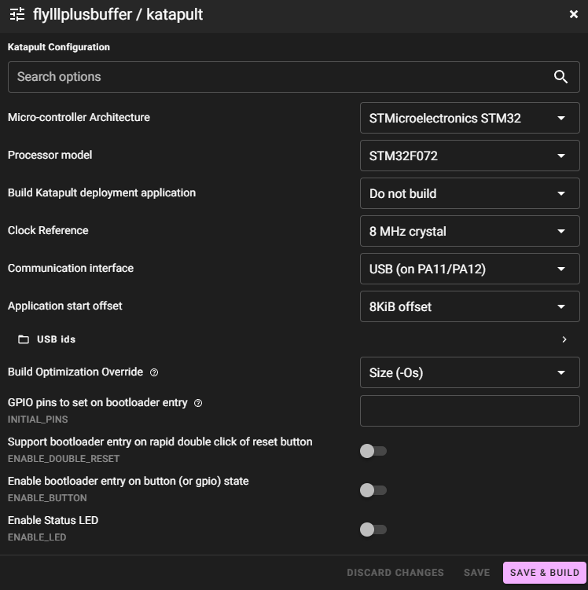
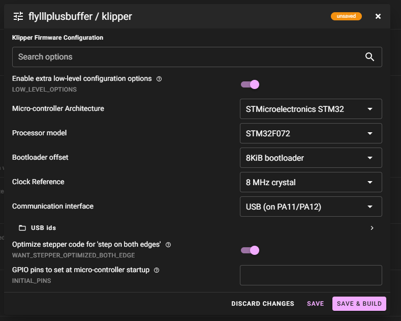

# buffer_manager — toolchanger-aware buffer, load & unload for Klipper

[](LICENSE)


A downstream fork of
**[Nitrooxyde/Mellow-LLL-Plus-Canonical](https://github.com/Nitrooxyde/Mellow-LLL-Plus-Canonical)**
that adds an **build specific features** for my **toolchanger** — six
buffers feeding six toolheads, one lane per tool, no splitter, and [specific hardware](#hardware).

Upstream built the buffer firmware and host control layer this is based on, and
did the hard work of proving the concept. It deliberately withdrew its automatic
load/unload pipeline. This fork puts one back, because the reasons it was
withdrawn do not apply to this machine — see
[Why this fork includes load and unload](#why-this-fork-includes-load-and-unload).
Mostly I'm experimenting with features that are very dependent on my current platform.

> **Nothing in this fork has run on hardware yet.** Every distance, duration
> and threshold in the load/unload pipeline is a commented placeholder. The
> firmware has not even been compiled — it builds only on a Klipper host.
> Treat this as a design under construction, not a release.

## Contents

- [Features](#features)
- [TODO](#todo)
- [Hardware](#hardware)
- [Why this fork includes load and unload](#why-this-fork-includes-load-and-unload)
- [How the load pipeline works](#how-the-load-pipeline-works)
- [Changes to upstream](#changes-to-upstream)
- [Install & update](#install--update)
- Everything below that is upstream's documentation, lightly amended.

## Features

- [x] Autonomous in-firmware auto-feed (inherited from upstream)
- [x] Board runs as a standard Klipper USB MCU (inherited)
- [x] External Feed/Retract buttons on PA2/PA3, handled in firmware so they
      keep working with Klipper down
- [x] Mellow MDM module connected on PA4/PA5 — presence event plus a free-running
      encoder pulse counter in `lll_state`
- [x] Protocol version handshake — a mismatched host/firmware pair refuses to
      start instead of silently misparsing
- [x] Three-phase pulsed load (push, assist, handoff)
- [x] Sensor-driven unload with an MDM-measured final margin
- [x] MDM/Roadrunner differential monitoring across the long bowden
- [x] Hardware-agnostic `[buffer_manager]` section behind a backend seam
- [x] English throughout (upstream is French)
- [ ] **Validated on hardware — nothing past this line is proven**
- [ ] Firmware compiled
- [ ] Feed rates, distances and thresholds measured
- [ ] `mdm_mm_per_count` confirmed against the Roadrunner
- [ ] Second backend (e.g. BTT EBB42) — the seam exists, no implementation

## TODO

- Bench everything. See the Verification section of
  [docs/PORT_RUNBOOK.md](docs/PORT_RUNBOOK.md).
- Confirm the PB12/PB13 board-level pull-up assumption with a multimeter. The
  external buttons on PA2/PA3 enable an internal pull-up and the internal pair
  does not; that asymmetry is inherited from the old fork and inferred, never
  measured.
- Confirm MDM presence polarity (assumed active-low) once it is wired.
- Measure real forward and back feed rates. `assist_speed` is currently
  inherited from an unrelated probe move and is almost certainly too slow.
- Decide whether `differential_action` graduates from `warn` to `error`.
- Document the mcu-updater flow properly once settled.

## Hardware

```python
Filamentalist V3 rewinder -> buffer -> MDM (on the buffer arm)
    -> long reverse bowden -> Roadrunner -> short bowden
    -> Extruder -> toolhead switch -> hotend
```

| Part | Role |
| --- | --- |
| [Filamentalist V3](https://github.com/Carrot-collective/Filamentalist_Rewinder/tree/main/Filamentalist_FV3_Rewinder) | Passive rewinder — takes back retracted filament |
| [Mellow FLY LLL Buffer Plus](https://mellow.klipper.cn/en/docs/ProductDoc/ExtensionBoard/fly-buffer-plus/) | Buffer and feed motor; runs this firmware |
| [Mellow MDM](https://mellow.klipper.cn/en/docs/ProductDoc/ExtensionBoard/fly-mdm/) | Encoder module - presence and motion - [Combined MDM and Buffer Slide](Combined-MDM-Mainbody-and-Buffer-Slide/) |
| [Roadrunner](https://github.com/EiNSTeiN-/roadrunner-filament-sensor/) | High-resolution filament sensor before the extruder |
| Toolhead switch | Plain switch after the extruder gear |

**The MDM and the Roadrunner bracket the long bowden**, which is most of the
path. That is the point: comparing them reveals filament moving at one end but
not the other — buckling *inside* the bowden, which neither sensor can see on
its own.

Whichever sensor the filament tip has **not yet passed** is the one that can
still measure it. That single idea drives the whole design — the MDM measures
the early load and the late unload, the Roadrunner measures the middle.

### MDM encoder scale

The MDM ships three printable encoder disks. The published "minimum detection
distance" is travel per **full segment cycle**, and the firmware counts **both**
edges — so one count is half that figure:

| Disk | Vendor distance | Edges/rev | `mdm_mm_per_count` |
| --- | --- | --- | --- |
| 3-segment | 5.8 mm | 6 | 2.90 mm |
| 5-segment *(installed)* | 3.5 mm | 10 | **1.75 mm** |
| 10-segment | 1.73 mm | 20 | 0.865 mm |

Segments times distance is constant at about 17.4 mm — the filament travel per
disk revolution, which cross-checks the reading. **Do not enter the vendor
figure directly**; that makes every MDM distance read twice too long.

## Why this fork includes load and unload

Upstream shelved its automatic pipeline citing three things: no toolhead
cutter, no passive respoolers, and fragility across a splitter/merger. Their
prototype needed two sensors *plus* a measured detector-to-splitter distance —
"that single distance is the whole calibration."

This machine differs on all three:

- **No splitter.** Six lanes, six toolheads, 1:1. The post-splitter detector
  and the calibrated tail do not exist here, and the calibration goes with
  them.
- **Passive respoolers present.** The Filamentalist V3 is precisely the
  missing equipment upstream named.
- **The cutter concern is defused, not solved.** A mushroomed tip still forms,
  but it only ever travels back up its own dedicated path and never negotiates
  a merger junction, which is one reason to introduce unreliable loads. On a
  toolchanger, when you have only one filament path per toolhead and loading/unloading
  actions are manually managed this is not the same type of concern.

In upstream's own words: *"If your setup has a toolhead cutter and passive
rewinders, the automatic path is realistic with what this repo ships."*

## How the load pipeline works

| Phase | What happens | Measured by |
| --- | --- | --- |
| **A — push** | Buffer jogs in short bounded pulses. Pulsed on purpose: a continuous push overshoots and buckles at any unguided gap. Cold-safe. | **MDM only** — filament has not reached the Roadrunner yet |
| **B — assist** | Extruder pulls while the buffer keeps pushing, until the toolhead switch confirms the gear grabbed. Needs heat. | Roadrunner, plus the differential check |
| **C — handoff** | Buffer returns to firmware autonomy; `loaded_gcode` runs. | — |

Unload reverses it: optional tip shaping (there is no cutter), a synchronized
retract until the toolhead switch and then the Roadrunner clear, and a final
margin measured with the **MDM** — because once the tip passes the Roadrunner,
nothing threads its wheel and it can no longer measure anything.

Loading is refused unless the lane's own extruder is Klipper's **active**
extruder, so a docked tool can never be driven by mistake.

## Changes to upstream

- `inform` (PA2/PA3 outputs signalling a non-Klipper mainboard) **deleted** —
  redundant under Klipper, which already receives `EV_BUTTON`.
- PA2/PA3 reclaimed as **external Feed/Retract buttons**, feeding the same
  firmware state machine as the internal pair.
- PA4/PA5 reclaimed as the **MDM module**. Both retired IOEXT channel pairs
  become permanently-refusing holes, so channel indices stay a stable contract
  for anyone's existing config.
- `lll_state` extended with `mdm_present`, `mdm_count` and `proto`.
- New host module `klippy/extras/buffer_manager.py` — the load/unload pipeline,
  behind a backend seam so the board can change later.
- Comments and user-facing strings translated to English.

Byte-identical parity with upstream is **not** a goal. `upstream/main` is kept
as a remote-tracking branch for reading their diffs and porting deliberately,
rather than for merging.

## Install & update

Host side (Klipper extras + `buffer.c`): clone this repo and run the install
script, which symlinks everything into your Klipper checkout.

```bash
cd ~
git clone https://github.com/Vylyne/buffer_manager.git
~/buffer_manager/install.sh
```

Klipper folder can be overridden by setting KLIPPER_DIR before running the script.

[Dashboard install instructions](dashboard/INSTALL.md)

Firmware side (build + flash this board): use
[mcu-updater](https://github.com/Vylyne/mcu-updater/) — it handles the
whole flow including first-time provisioning from DFU, and automatically
adds/removes the Klipper Makefile patch for the build. CLI
(`./mcu-updater add-mcu --type flylllplusbuffer`), a guided interactive
console menu (select the type from a list), or a Mainsail-fork panel, in
increasing order of hand-holding. Example config for this firmware:

```ini
[type flylllplusbuffer]
chipset: stm32f072xb
klipper_makefile_patches:
    src/Makefile -> src-y += buffer.c
firmware: klipper, katapult
serials:
    871A6FC9BCE62A9C1B0A813F-if00  # mcu T0_buffer
    4250CF550462AEA097AEBBFC-if00  # mcu T1_buffer
    2079CA43E1E79399AD4C3B75-if00  # mcu T2_buffer
    8AA2F6DC15113101D0CEA4BF-if00  # mcu T3_buffer
    D5A1792666DB424A9DF62E17-if00  # mcu T4_buffer
    533517F4A9E059C80E2929A1-if00  # mcu T5_buffer
```

### Katapult menuconfig



### Klipper menuconfig



**Target**: STM32F072, 8 KiB bootloader offset (application address `0x8002000`,
must match Katapult), 8 MHz crystal, USB on PA11/PA12. No motor/stepper/TMC
section in printer.cfg — the firmware owns the motor; the host talks to it
through `[lll_buffer]` (see [Configuration](#configuration)).

---

## Safety hardening

Nine fixes, **inherited from upstream**:

1. `sched_is_shutdown()` guard as the **literal first line** of the buffer task, plus a `DECL_SHUTDOWN` handler that drives the motor enable high. **Bench-proven:** an `M112` fired in the middle of a commanded `LLL_RUN` cuts the motor dead.
2. **Single-writer**: command handlers set flags only — only the task and the shutdown handler ever touch EN/UART.
3. A forward run requires `present && !error`, re-checked **every tick**; backward runs stay allowed on runout (legitimate unload).
4. `back_timeout` (default 60 s) on parked follow and commanded back runs.
5. Critical pins (5 V headers PB8/PB9, host lines PB14/PB15, USB, SWD, TMC UART, halls, PB7, buttons) are **outside the IOEXT table** — index-only addressing makes them unreachable, not merely forbidden.
6. Every stop writes `VACTUAL=0` **before** re-asserting enable; every motion rewrites GCONF+VACTUAL.
7. Roles / modes / enables / tweaks are replayed in Klipper's **config sequence** (before `ready`) — `role: parked` closes the startup window on Klipper restarts.
8. **No UART bit-bang inside command handlers**; runtime TMC writes are deferred and spaced inside the task.
9. **Boot grace period**: after a hard MCU reset (`FIRMWARE_RESTART`, `M112`, power-cycle), no autonomous feed starts until the host has spoken once (20 s cap) — closes the phantom-push window of the compiled defaults; the done-latch is evaluated every tick so the grace can never re-arm (timer wrap included). **Field-proven:** `FIRMWARE_RESTART` with a fully-tensioned arm → zero motion. See [Known behaviour](#known-behaviour--limitations) for the deliberate standalone trade-off.

---

## Host G-code commands

All commands take `LANE=<lane>` (the `[lll_buffer <lane>]` section name), except `LLL_DETECT_LOADED` which is global.

| Command | What it does |
| --- | --- |
| `LLL_QUERY` | Full state report: role, mode, error/ecode, feeding, running, arm position, filament present, diag, cfgerr |
| `LLL_ROLE` | Set lane role `active` / `parked` / `standby` (persistent) |
| `LLL_SET_IDLE` | Backwards-compat alias (`VALUE=1` → parked, `0` → active) |
| `LLL_MODE` | Set FEED automation level `auto` / `semi_auto` / `semi_manual` / `manual` |
| `LLL_ARM` | Arm exactly one feed cycle (semi_auto mode) |
| `LLL_ENABLE` | Toggle one of the 11 functions at runtime |
| `LLL_SET` | Set a runtime parameter (timeouts, TMC current/microsteps/stealth, run limits, telemetry mask…) — persisted |
| `LLL_JOG` | Bounded jog `fwd` / `back` / `stop`, clamped to 10 s |
| `LLL_RUN` | Bounded run with deadline (`MS=0` → `run_max_ms`), refreshable |
| `LLL_STOP` | Stop host-commanded motion (autonomous behaviour resumes) |
| `LLL_CLEAR_ERROR` | Clear a latched jam/error (refused while a driver fault is still asserted) |
| `LLL_PROFILE_SAVE` | Save current tweaks as a named profile |
| `LLL_PROFILE_LOAD` | Apply a named profile (persists as current) |
| `LLL_PROFILE_LIST` | List saved profiles |
| `LLL_PROFILE_DELETE` | Delete a named profile |
| `LLL_FILAMENT` | Register the filament loaded on this lane (`TYPE=`, `COLOR=`, `TEMP=`, `SPOOL_ID=` for Spoolman) |
| `LLL_UNLOCK` | Unlock unverified IOEXT pins for the session (`KEY=0xDEB1`) |
| `LLL_IO_CFG` | Configure an IOEXT channel (din / dout / soft-PWM / ADC / release) |
| `LLL_IO_WRITE` | Write an IOEXT dout / PWM duty |
| `LLL_IO_READ` | Read an IOEXT channel |
| `LLL_DETECT_LOADED` | **Global**: probe which lane is physically loaded, using only the arm sensors (`EXPECTED=`, `ON_MISMATCH=warn\|pause\|error`) |

Full manual with parameters, examples and pitfalls: **[docs/LLL_COMMANDS_MANUAL.en.md](docs/LLL_COMMANDS_MANUAL.en.md)** (English) · **[docs/COMMANDES_LLL_MANUEL.fr.md](docs/COMMANDES_LLL_MANUEL.fr.md)** (French).

---

## Configuration

Start from **[config/printer.cfg.example](config/printer.cfg.example)** — one `[mcu]` + one `[lll_buffer]` pair per board:

```ini
[mcu LLL_PLUS]
serial: /dev/serial/by-id/usb-Klipper_stm32f072xb_XXXXXXXXXXXX-if00
restart_method: command

[save_variables]
filename: ~/printer_data/variables.cfg

[lll_buffer lll]
mcu: LLL_PLUS
role: parked
```

Two things matter:

- **`role: parked` is the recommended startup role.** The compiled-in default is `active`/`auto` ("keep buffering" even with no host), so there is a short window at startup where the board could push filament before Klipper's config arrives. `role: parked` closes that window for **Klipper restarts** (the role is replayed in the config sequence, before `ready`). Activate the lane you actually print with afterwards: `LLL_ROLE LANE=lll ROLE=active`. See [Known behaviour](#known-behaviour--limitations) for the hard-MCU-reset case.
- **`[save_variables]` is required for persistence.** Roles, modes, enables, `LLL_SET` tweaks, profiles and filament declarations are stored there and **replayed to the board at every connect** — your tuning survives restarts and re-flashes.

Optional section options: `feed_mode:` (startup automation level), `enable:` / `disable:` (force functions on/off from config), `poll_interval:` (state refresh, default 1.5 s), and `event_gcode:` (a Jinja template run on **every** event the board pushes — e.g. `PAUSE` on a jam within ~20–50 ms).

### Load and unload: `[buffer_manager]`

`[lll_buffer]` only talks to the board. The load/unload pipeline is a second
section on top of it, one per lane, named after the lane it drives:

```ini
[lll_buffer t0]
mcu: T0_buffer
role: parked
event_gcode:
    BUFFER_LOAD_EVENT LANE=t0 NAME={event.name} VALUE={event.value}

[buffer_manager t0]
lane: t0
extruder: extruder
roadrunner_sensor: T0_roadrunner
post_extruder_sensor: T0_filament_sensor
```

- The `event_gcode` bridge line is **required**: it is how the pipeline hears
  arm and MDM events, and `buffer_manager` refuses to start without it.
- `extruder` must be this lane's own extruder. `BUFFER_LOAD_BEGIN` and
  `BUFFER_UNLOAD` are refused unless it is the active extruder and the lane's
  role is `active`.
- The toolhead switch is either `post_extruder_pin` (a raw pin
  `buffer_manager` owns) or `post_extruder_sensor` (an existing
  `[filament_switch_sensor]` on that switch). Klipper allows one owner per
  pin, so if the switch is already a runout sensor, use
  `post_extruder_sensor`. Omit both it and `roadrunner_sensor` to use the
  sensorless arm-settle fallback instead.

Commands: `BUFFER_LOAD_BEGIN LANE=t0`, `BUFFER_LOAD_ABORT LANE=t0`,
`BUFFER_UNLOAD LANE=t0`, `BUFFER_UNLOAD_ABORT LANE=t0`. Every other option,
and the fact that all of its distances and timings are untested
placeholders, is in [config/printer.cfg.example](config/printer.cfg.example).

### Entrance sensor

The entrance sensor can still pause the print the classic way — it is exposed as a normal MCU pin:

```ini
[filament_switch_sensor lll_entrance]
switch_pin: ^!LLL_PLUS:PB7
pause_on_runout: True
```

---

## Dashboard & UI

An optional, self-contained control panel (`dashboard/index.html`) displayed **inside Mainsail** as an interactive iframe webcam card. No Mainsail fork, no plugin, no extra service — one static file served by the nginx you already have:

```nginx
location /lll/ { alias /home/pi/lll_dashboard/; index index.html; add_header Cache-Control "no-store"; }
```

- Talks to Moonraker over its WebSocket through Mainsail's existing proxy — same origin, **zero CORS configuration**.
- **Auto-discovers every lane**: declare a new `[lll_buffer <lane>]` and its card appears by itself.
- **VCR-style transport** per lane: **hold** = jog, **double-click** = continuous, **single click** = stop. Continuous mode is a stream of **10-second-bounded orders refreshed every 3 s** — the page never sends an unbounded command, so if the browser dies mid-run the motor stops on its own in under 10 s.
- **Feed-gate aware** (v1.0.2): the footer always shows *active lane · loaded lane*; when the safety gate freezes a lane (selected while a different one is still physically loaded), its card shows a **frozen badge** and a one-click **unfreeze** (deliberate override: reset the loaded-lane memory and re-arm). A header **filament check** button runs `LLL_DETECT_LOADED` on demand.
- **Language follows Mainsail's own setting** (read from the Moonraker database), falling back to the browser language. English and French bundled.
- **Spoolman** (optional): run Spoolman as its own service (port 7912), add `[spoolman]` with `server: http://localhost:7912` / `sync_rate: 5` to `moonraker.conf` → Mainsail's native spool panel appears, and `LLL_FILAMENT ... SPOOL_ID=` links a lane to a spool. **When a lane becomes active, its spool becomes Moonraker's active spool** — per-spool usage tracking follows the lane.
- **LCD menu** (optional): [config/lcd_menu_lll.cfg.example](config/lcd_menu_lll.cfg.example) for a BTT MINI12864 — per-lane state + Activate / Park / Clear error. Safe manual-rewind workflow: **Park → physical buttons → Activate** (a parked lane never re-feeds forward under you).

Full walkthrough: **[dashboard/INSTALL.md](dashboard/INSTALL.md)**.

---

## TMC2208 register values

Derived directly from Mellow's firmware parameters (via the `TMCStepper` library it uses), not guessed:

| Register | Value | Notes |
| --- | --- | --- |
| GCONF | `0x000001C4` | spreadCycle, pdn_disable, mstep_reg_select (shaft bit set for FORWARD) |
| CHOPCONF | `0x12020055` | toff=5, vsense, 64 µsteps, intpol |
| IHOLD_IRUN | `0x00010F07` | IRUN=15, IHOLD=7 (≈ `rms_current(500)` @ Rsense 0.11) |
| PWMCONF | `0xC10D0024` | pwm_autoscale |
| VACTUAL | `77575` | 260 rpm, 64 µsteps |

With the canonical firmware you no longer need to edit the source to tune these: `LLL_SET LANE=... PARAM=...` changes current (IRUN/IHOLD), microsteps, stealthChop, standstill mode, TPOWERDOWN and the VACTUAL magnitude at runtime — persisted and replayed at boot. Bounds are clamped to the deployed known-good values; don't raise the current without your motor's datasheet.

---

## Known behaviour & limitations

### Mainsail shows MCU load ~100 % (false positive)

Once this firmware is running, Mainsail's **MCU Load** bar for the LLL Plus may read **~100 %**. **This is a false positive — the MCU is not overloaded.**

The auto-feed task bit-bangs the TMC2208 `VACTUAL` value over a software UART. Each update is a short, tightly-timed burst (~8 ms), which inflates the per-task timing **standard deviation** that Mainsail's load indicator is built on — even though the MCU is idle the vast majority of the time.

Measured over a full print (`klippy.log` / MCU stats):

| Metric | Value | Meaning |
| --- | --- | --- |
| `mcu_awake` | ~0.03–0.06 | awake only **~3–6 %** of the time |
| `mcu_task_avg` | ~0.4 ms | tasks are short |
| `mcu_task_stddev` | ~2.5 ms | spikes from the bit-bang `VACTUAL` bursts (~8 ms) — this is what drives the "100 %" bar |
| `send_seq` vs `receive_seq` | equal | no command backlog |
| retransmits | a few bytes over a whole print | link healthy |
| "Timer too close" / shutdowns | **0** | no real overload |

**Conclusion:** display artifact of the bit-bang timing jitter. Auto-feed, buttons and runout all keep working normally — no action needed.

### Feed dead band between the STOP and PUSH hall zones (by design)

The state machine — identical to Mellow's standalone, all versions — starts a feed **only when the tension arm reaches the hall3 (push) position** and stops it at hall2 (balanced). Between the two there is a dead band (**~13 mm of filament on the reference setup**) during which the extruder pulls against the buffer alone until the arm travels back to hall3. This is inherent to the three-sensor design, not a fault; it matters if you're diagnosing brief tension rises right after a feed cycle ends.

### Startup after a hard MCU reset — fixed by the boot grace period (fix #9)

The compiled-in defaults are `active` / `auto` (deliberate: a board that loses its host **keeps buffering**). After a **hard MCU reset** (`FIRMWARE_RESTART`, an `M112` emergency stop, or a power-cycle) the task runs on those defaults before Klipper's config arrives — on earlier builds this caused a brief phantom filament push whenever the tension arm was loaded. **The shipped firmware closes this**: no autonomous step-9 motion (forward feed or active-role back-follow) starts until the host has spoken once, capped at 20 s. Buttons, jog, run, roles and the parked follow stay live during the grace. Field-proven on the reference setup: `FIRMWARE_RESTART` with a fully-tensioned arm → zero motion, arm position unchanged.

Two honest notes:

- **Deliberate standalone trade-off, not Mellow parity**: a board that is *never* host-driven starts auto-feeding 20 s after power-on, where Mellow's stock standalone firmware starts ~1 s after boot. That one-time latency is the price of closing the post-reset push.
- `role: parked` in printer.cfg remains recommended as a complementary layer (it also covers the case of a Klipper host that stays down longer than 20 s with a tensioned arm).

---

## Field validation status

**This is about the canonical firmware core (roles, modes, buttons, IOEXT,
TMC, telemetry) — not the load/unload pipeline.** The pipeline
(`klippy/extras/buffer_manager.py`, tasks T8–T10) is what the top-of-file
banner and [CLAUDE.md](CLAUDE.md) mean by "nothing has run on hardware yet";
every distance/duration/threshold in it stays an unbenched placeholder
regardless of what this section says about the core below it.

Honest scope of what has been tested:

- **One reference setup**: a single printer, **two LLL Plus boards** (two lanes), STM32F072CB.
- The shipped binary has been running **in production** on both boards since its build date, through **multiple real multi-day prints including filament color changes**.
- **Bench-tested module by module**: roles, modes, enables, bounded jog/run, error latch/clear, IOEXT gating, telemetry events, profile persistence, and the `M112` shutdown kill.
- **Not exercised on this setup** (no hardware/wiring to trigger them): mainboard signal control (PB5/PB6) beyond bench checks, and non-default IOEXT wiring on the spare headers.
- **No other board revision or hardware combination has been tested.** Pins and register values are specific to this board.

---

## Host macros (example)

**[config/lll_macros.cfg.example](config/lll_macros.cfg.example)** ships the multi-lane orchestration layer used on the reference setup: `SET_ACTIVE_LANE`, `_LLL_INIT`, the `Tn` / `_COLOR_CHANGE` tool-change entry points, `LLL_PANEL`, and friends. It is the layer the dashboard and the command manuals refer to. Copy it into your `printer.cfg` (or `[include]` it) and adapt lane names, temperatures and purge values to your machine.

Since **v1.0.2** this layer ships a **feed-gate**: `SET_ACTIVE_LANE` never arms a lane's autonomous feed while a *different* lane is physically loaded (`lll_loaded_lane` memory, written by `LLL_DETECT_LOADED`), with automatic re-arm during a swap once the old filament has left the extruder entry — see the [CHANGELOG](CHANGELOG.md) for the field incident behind it.

## Multicolor / automatic filament change — status

On the reference setup, filament color changes are done **manually**: there is no automatic cutter and no passive respoolers, so a human swaps the filament at the `Tn` pause. A complete automatic pipeline (unload / load / resume orchestration) was prototyped and did work, but it is **not shipped** in this repo. Full, honest breakdown of what works, what was prototyped and what is missing: **[docs/MULTICOLOR_STATUS.en.md](docs/MULTICOLOR_STATUS.en.md)** (English) · **[docs/MULTICOLOR_STATUS.fr.md](docs/MULTICOLOR_STATUS.fr.md)** (French).

## Experimental: Phase C (v1.1) — informational only

The **[experimental/phase-c/](experimental/phase-c/README.md)** folder exposes, purely for information and **without any official status**, a 46-line evolution of the firmware: a grace period at boot plus an optional `rewind_pause` behaviour. It was written, reviewed, flashed and bench-tested — then **withdrawn from the reference setup**: the `rewind_pause` option proved dangerous on a lane actively printing. Since then, **its grace-period half has been re-derived, hardened (tick-level done-latch) and integrated into the official firmware as safety fix #9** — what remains specific to this folder is the `rewind_pause` story. It is provided as-is for feedback and testing by people who know what they are doing; it is **not** what the shipped binary contains. Details, diff and post-mortem: [experimental/phase-c/README.md](experimental/phase-c/README.md).

## 🙏 We're asking for your feedback — it's what makes this evolve

This firmware has been validated on **one** setup. If you get the chance to
try it on yours, **please tell us how it went** — we are genuinely asking:

- **It misbehaved?** Open a [🐛 bug report](../../issues/new?template=bug_report.yml)
  — and give us as much detail as you can on **how the problem presented
  itself** (when, doing what, repeatable or not, `LLL_QUERY` output, log
  excerpt). That detail is exactly what lets us keep improving this repo.
- **It worked? Partially? Surprised you?** A [🧪 field test report](../../issues/new?template=test_report.yml)
  is just as valuable — successes from different setups tell us what is
  solid, failures tell us what to fix next.
- PRs welcome too, and general discussion lives in the
  [TeamFDM thread](https://www.teamfdm.com/forums/topic/7617-faster-printing-requiring-filament-buffer-feeding/)
  where this project took shape.

Don't hesitate — no report is too small, and none of them will be met with
anything but gratitude.

## Language note

This is stale as an upstream-parity claim and kept only as a historical note:
an earlier version of this document said the shipped sources were
byte-identical to a French-commented upstream deployment, and that
translating them would be refused for that reason. That is no longer this
fork's policy — see [CLAUDE.md](CLAUDE.md): byte-identical parity with
upstream is **explicitly abandoned**, and comments are translated to English
as they are touched (see [Changes to upstream](#changes-to-upstream), and
task T5 in [docs/PORT_RUNBOOK.md](docs/PORT_RUNBOOK.md)). Any remaining
French text is inherited from a file this fork has not yet touched, not a
guarantee. The one artifact this note doesn't apply to is
[`build/klipper_canonical_v1_fix9.bin`](build/klipper_canonical_v1_fix9.bin)
itself — a compiled binary can't be "translated" after the fact, and it
predates this fork's PA2/PA3 buttons, PA4/PA5 MDM, and protocol-version
changes regardless of language.

---

## Status / disclaimer

**⚠️ No warranty — use at your own risk.** This is experimental, community firmware provided **AS-IS, with NO WARRANTY of any kind** (see the [GPL-3.0](LICENSE) license — *Disclaimer of Warranty* §15 and *Limitation of Liability* §16). Flashing MCU firmware **can brick the board or damage hardware**. You assume **all** risk; the authors accept **no liability** for any damage, bricked board, failed/ruined print, or other loss. **Back up your existing firmware first** (Step 2) and make sure you understand each step before running it.

**We tested this as far as our own hardware allowed — no further.** Everything marked "field-proven" was proven on **one** reference setup (two lanes, one printer); anything beyond that (other boards revisions, other printers, more lanes, the multicolor pipeline itself) is *your* experiment, on *your* responsibility. If you follow this repo, you do so at your own risk — and we would genuinely love to hear how it went, but we are in no way responsible for the outcome.

## Credits — who did what

This project did not start here, and it was not built by one pair of hands:

- **The idea comes from the community.** It grew out of many reads through the Voron community and the TeamFDM forums (notably [this buffer-feeding thread](https://www.teamfdm.com/forums/topic/7617-faster-printing-requiring-filament-buffer-feeding/)) and the research they pushed us into — that is what motivated this little project in the first place. [Fly3DTeam / Mellow](https://github.com/Fly3DTeam/Buffer) published the original FLY Buffer firmware & hardware (the autonomous state machine is ported from their open source); [river29](https://github.com/river29/Mellow-LLLBufferPLUS-klipper), [ss1gohan13](https://github.com/ss1gohan13/BufferPLUS-klipper) and [depau/lll-buffed](https://github.com/depau/lll-buffed) opened the Klipper road before us.
- **Constraints, resolutions and field testing — [Nitrooxyde](https://github.com/Nitrooxyde).** The design decisions under real-world constraints (USB-only, one board per lane, park-first safety, sensors at determined positions with measured distances) and every hour of bench and production validation on the reference setup.
- **Implementation — Claude (Anthropic's AI).** The firmware, the host extra, the dashboard and the documentation were written by Claude working in pair with Nitrooxyde — it is what made this project possible, and it is stated here openly (see also the `Co-Authored-By` in the commit history). We would rather say it upfront than have anyone feel misled.
- **[Klipper](https://github.com/Klipper3d/klipper)** — MCU firmware framework and host.
- **[Katapult](https://github.com/Arksine/katapult)** — USB bootloader. Install guide without opening the case: [LLL-Plus-Katapult-NoDFU](https://github.com/Nitrooxyde/LLL-Plus-Katapult-NoDFU).
- **[Spoolman](https://github.com/Donkie/Spoolman)** — spool database (optional integration).

## License

[GPL-3.0](LICENSE) — derived from GPL-3.0 sources (Fly3DTeam/Buffer, Klipper).
