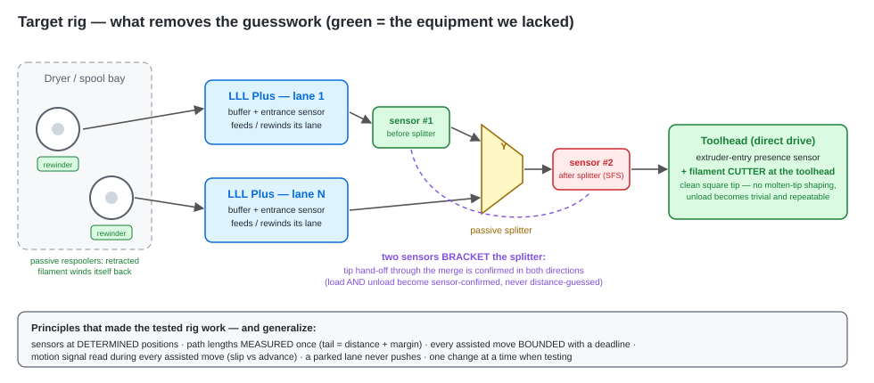

# L'histoire du projet — du multicouleur avec juste des buffers

> English version: [THE_PROJECT_STORY.en.md](THE_PROJECT_STORY.en.md)

## L'objectif

Imprimer **multicouleur / multi-matière sur un seul toolhead direct-drive,
sans MMU à sélecteur** — pas d'ERCF, pas de BoxTurtle, pas d'AMS, pas de
toolchanger. Juste **un buffer Mellow LLL Plus par voie de filament**,
fusionnées par un splitter passif vers l'unique chemin filament de
l'imprimante, avec Klipper qui orchestre quelle voie est active.

Pourquoi cette forme :

- **Modulaire et plug-and-play** : chaque voie = une carte sur un câble USB
  (+ 24 V). Ajouter une voie = une section `[mcu]` + une section
  `[lll_buffer]`. Zéro mécanique de sélecteur, zéro calibration de gates.
- **Les buffers étaient de toute façon nécessaires** : sur le setup de
  référence, l'imprimante est alimentée **de l'extérieur**, avec les
  filaments techniques dans un **dryer** — les longs chemins d'amenée
  exigent un buffering actif, multicouleur ou pas.
- **Une voie `parked` ne pousse jamais** — le firmware le garantit. Changer
  de couleur = parquer la voie courante, la reculer hors du splitter,
  activer la suivante.

## Ce qui a été prouvé

- **Deux voies ont tourné en production** sur le setup de référence : des
  prints réels avec changements de couleur, le workflow de swap
  manuel/semi-manuel, les rôles par voie, runout → pause, le dashboard et
  le menu LCD. C'est ce que ce dépôt livre.
- **Le pipeline de déchargement/chargement entièrement automatique a été
  prototypé de bout en bout, et il fonctionnait** : retract synchronisé
  (extrudeur + buffer en recul ensemble — un extrudeur qui tire seul contre
  tout le chemin patine), phases séquencées par capteurs (entrée extrudeur
  libérée → détecteur post-splitter libéré), puis une **queue calibrée** =
  la distance mesurée détecteur→splitter + marge, qui parque la pointe du
  filament juste en dehors de la fusion. Le chargement était pulsé jusqu'à
  confirmation par le capteur d'entrée extrudeur. Méthode complète :
  [MULTICOLOR_STATUS.fr.md](MULTICOLOR_STATUS.fr.md).

La leçon la plus importante : **rien dans le chargement/déchargement ne
doit relever du hasard**. Un capteur à une position *déterminée* plus une
distance *mesurée* transforment « espérons que la pointe est sortie » en
séquence déterministe et répétable. Notre SFS placé à un point connu après
le splitter, avec la distance SFS→splitter mesurée une fois, a rendu les
longueurs de déchargement exactes. Le capteur d'entrée extrudeur (Smart
Orbiter) a fait de la fin de chargement un événement confirmé, pas une
poussée à l'aveugle.

## Ce qui nous a freinés — l'équipement, pas le concept

Nous avons retiré le pipeline automatique du périmètre officiel, et la
raison honnête est **le matériel manquant**, pas l'architecture :

| Pièce manquante | Conséquence dans nos tests |
|---|---|
| **Pas de cutter au toolhead** (toolhead XOL, mod cutter pas encore monté) | Chaque déchargement devait mettre en forme puis tirer une **pointe fondue** (champignon) à travers tout le chemin — procédures longues, à chaud, fragiles |
| **Pas de ré-embobineurs passifs** (type Filamentalist) | Le filament reculé restait à la charge des seuls buffers ; le stockage de la voie libérée est resté un problème ouvert |
| **Pas de roue codeuse de mesure sur le chemin** avant tard dans le projet | Les premiers chargements/déchargements tournaient en boucle ouverte ; c'est l'arrivée du SFS qui a donné le signal glisse-vs-avance — le diagnostic le plus utile qu'on ait trouvé |
| **Friction accumulée du chemin** (un support de capteur mal orienté, des couplers, les longs PTFE depuis le dryer externe) | Les épisodes de patinage ont mâché le filament ; un filament mâché accroche partout, ce qui a empoisonné tous les tests suivants |

Dans ces conditions, la pile d'automatisation a enflé — du logiciel pour
compenser de la mécanique — jusqu'à ce que la machine ne puisse même plus
imprimer proprement en une couleur. Tout a été ramené au cœur propre et
validé (ce dépôt), et le pipeline est resté à l'état de documentation.

## La conclusion honnête — c'est tout à fait faisable

**Avec le bon équipement, le multicouleur 100 % LLL est un objectif sain et
atteignable.** Ce qu'il faut : une *installation saine et propre* et des
*capteurs qui enlèvent le hasard* du chargement et du déchargement :

- **Un cutter au toolhead** → pointe nette, zéro mise en forme de pointe
  fondue : les phases de déchargement perdent presque tous leurs modes de
  défaillance.
- **Des ré-embobineurs passifs par bobine** → le filament reculé se
  rembobine tout seul ; la voie libérée est réellement rangée.
- **Un capteur filament à position déterminée après le splitter**, avec la
  distance splitter **mesurée une fois** — prouvé sur notre banc : la
  longueur de queue devient exacte.
- **Renforcer avec un second capteur avant le splitter** : deux capteurs
  qui *encadrent* la fusion confirment le passage de la pointe dans **les
  deux sens** — chargement et déchargement deviennent confirmés par
  capteur, plus jamais devinés à la distance.
- **Un capteur de présence à l'entrée extrudeur** (classe Smart Orbiter)
  valide que le filament est réellement arrivé.
- Les capteurs d'entrée par voie + la télémétrie du bras des buffers
  couvrent le reste.

Toutes les primitives firmware nécessaires à ces séquences sont déjà dans
ce dépôt : rôles par voie, mouvements bornés (`LLL_JOG`/`LLL_RUN`),
événements de télémétrie avec `event_gcode`, identité filament
(`LLL_FILAMENT`), sonde physique de voie (`LLL_DETECT_LOADED`).

C'est un projet de **petites étapes et de détails** — distances mesurées,
positions de capteurs déterminées, mouvements bornés, un changement à la
fois. Chacun de ces détails ne coûte presque rien ; c'est les sauter qui
coûte cher.
